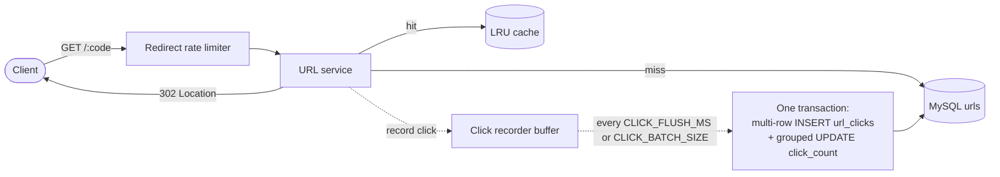

# URL Shortener Service

A small bit.ly style URL shortener. `POST /shorten` stores a long URL under a generated code and `GET /:code` redirects to it and records the click. It's written with Node.js 22, Express 5 and MySQL using plain SQL: no ORM, no query builder, every statement lives in [src/constants/queries.js](src/constants/queries.js).

The interesting part is the redirect path. A visitor gets their `302` as soon as the destination is known; the database work for analytics happens afterwards, in batches.

## How a request flows



- **Codes** are 8 base62 characters from `crypto.randomInt`, so they can't be predicted from earlier ones.
- **Collisions** are caught by the unique index on `urls.short_code`. On a duplicate key the service generates a new code and retries, up to `SHORT_CODE_MAX_ATTEMPTS` times. There is no SELECT-before-INSERT, which would be a race.
- **Lookups** go through an in-memory LRU cache with a TTL. Misses are cached briefly too (`CACHE_MISS_TTL_MS`), so scanning random codes doesn't cost one query per guess. Rows are never updated after insert, so a cached destination can't go stale.
- **Clicks** are buffered in memory and written as one multi-row `INSERT` plus one grouped `UPDATE` inside a single transaction. The trade-off: `click_count` lags by up to `CLICK_FLUSH_MS`, and a hard kill can lose the current buffer. SIGTERM flushes it before exit.
- **Rate limits** are per client, with separate budgets for creating links (10/min) and for redirects (600/min). `X-Forwarded-For` is ignored unless `TRUST_PROXY=true`, because otherwise any client could reset its own bucket with one header.
- **Errors** use one shape, `{"error": {"code", "message", "details"}}`. Only errors the application raised on purpose show their message; anything unexpected returns a generic 500 with an `incidentId` that matches the server log line.

[docs/performance.md](docs/performance.md) has measured statement counts for the cache and the batched writer.

The schema is in [sql/schema.sql](sql/schema.sql): a `urls` table and a `url_clicks` table with one row per redirect.

## Running it

### Docker Compose

Starts MySQL 8.4, applies the schema once with a one-shot `migrate` service, then starts the app on port 3000:

```bash
docker compose up --build
```

Ports are published on `127.0.0.1` only, since the development MySQL has a passwordless root. Set `APP_HOST_PORT` or `DB_HOST_PORT` if 3000 or 3306 are taken. `docker compose down -v` removes the database volume.

### Without Docker

Needs Node.js 22.12 or later (see `.nvmrc`) and a MySQL 8 server.

```bash
npm install
cp .env.example .env   # set your MySQL credentials
npm run db:init        # creates the database and tables
npm run dev            # http://localhost:3000, restarts on file changes
```

If you don't have MySQL handy, `STORAGE_DRIVER=memory npm start` runs the service with an in-memory store instead. Data is lost when the process stops.

## Using it

These responses were captured from the Compose stack (the run used `APP_HOST_PORT=38300`; URLs are shown with the default port). Headers are trimmed to the ones that matter.

Create a short URL:

```console
$ curl -s -i -X POST http://localhost:3000/shorten \
    -H 'Content-Type: application/json' \
    -d '{"url":"https://dev.mysql.com/doc/refman/8.4/en/innodb-locking.html"}'
HTTP/1.1 201 Created
RateLimit-Limit: 10
RateLimit-Remaining: 9
RateLimit-Reset: 1794129674
Content-Type: application/json; charset=utf-8

{"shortUrl":"http://localhost:3000/M6KFG6Rv","code":"M6KFG6Rv","originalUrl":"https://dev.mysql.com/doc/refman/8.4/en/innodb-locking.html"}
```

Follow it:

```console
$ curl -s -o /dev/null -D - http://localhost:3000/IBjETPcl
HTTP/1.1 302 Found
RateLimit-Limit: 600
RateLimit-Remaining: 599
Cache-Control: private, no-store
Location: https://nodejs.org/api/test.html
```

`Cache-Control: private, no-store` is deliberate: a cached 302 would let browsers skip the service on later visits, and the click would never be counted.

Errors:

```console
$ curl -s http://localhost:3000/zzzzzzzz
{"error":{"code":"NOT_FOUND","message":"Short URL not found.","details":null}}

$ curl -s -X POST http://localhost:3000/shorten -H 'Content-Type: application/json' \
    -d '{"url":"javascript:alert(1)"}'
{"error":{"code":"VALIDATION_ERROR","message":"Only http and https URLs are supported.","details":{"allowedProtocols":["http:","https:"]}}}

$ curl -s -i -X POST http://localhost:3000/shorten -H 'Content-Type: application/json' \
    -d '{"url":"https://example.com/one-more"}'      # once the 10/min budget is spent
HTTP/1.1 429 Too Many Requests
Retry-After: 58

{"error":{"code":"RATE_LIMIT_EXCEEDED","message":"Rate limit exceeded.","details":{"retryAfterSeconds":58,"limit":10,"windowMs":60000}}}
```

The full transcript, including what landed in MySQL, is in [docs/api-walkthrough.md](docs/api-walkthrough.md).

| Method | Path       | Response                                          |
| ------ | ---------- | ------------------------------------------------- |
| POST   | `/shorten` | 201 with `shortUrl`, `code` and `originalUrl`     |
| GET    | `/:code`   | 302 redirect, or 404                              |
| GET    | `/healthz` | 200 (liveness; used by the container healthcheck) |
| GET    | `/readyz`  | 200, or 503 if storage is down                    |

URLs must be `http` or `https` and at most 2048 characters after percent-encoding.

## Configuration

Everything is listed with defaults in [.env.example](.env.example). The ones you're most likely to touch:

| Variable                  | Default | What it does                                                         |
| ------------------------- | ------- | -------------------------------------------------------------------- |
| `STORAGE_DRIVER`          | `mysql` | `memory` runs without a database                                     |
| `SHORT_CODE_LENGTH`       | `8`     | Up to 16, the width of `urls.short_code`; larger values fail at boot |
| `CACHE_TTL_MS`            | 300000  | How long a resolved code stays cached                                |
| `CLICK_FLUSH_MS`          | 1000    | Upper bound on how far `click_count` lags                            |
| `CLICK_IP_MODE`           | `full`  | `anonymized` keeps the IPv4 /24 or IPv6 /48; `none` stores nothing   |
| `TRUST_PROXY`             | `false` | Only enable behind a proxy you control that rewrites XFF             |
| `RATE_LIMIT_MAX_REQUESTS` | 10      | Creates per client per `RATE_LIMIT_WINDOW_MS`                        |

## Tests

```bash
npm test          # unit and HTTP tests against the in-memory driver
npm run lint
npm run format:check
```

The HTTP tests boot the real middleware stack on an ephemeral port; only storage is swapped for the in-memory repository.

The MySQL repository has its own integration suite that runs the raw SQL against a real server. Apply the schema to a throwaway database first:

```bash
DB_NAME=url_shortener_test npm run db:init
DB_NAME=url_shortener_test npm run test:mysql
```

`docker build --target build .` runs lint and the test suite inside the image build.

## Project layout

```
src/
  server.js          process concerns: listen, signals, graceful shutdown
  container.js       composition root; every collaborator is built here
  app.js             Express app from injected collaborators, no env access
  services/          URL service (validation, retries, cache) and click recorder
  repositories/      mysql and memory implementations of one storage port
  middleware/        rate limiter, request logger, error handler
sql/schema.sql       table DDL
scripts/             schema initialiser and the redirect benchmark
```

## Limitations

- The cache and rate limiter are per process. Running more than one instance would need a shared store like Redis.
- There's no auth, no custom aliases and no endpoint to read click stats back.

## License

MIT, see [LICENSE](LICENSE).
